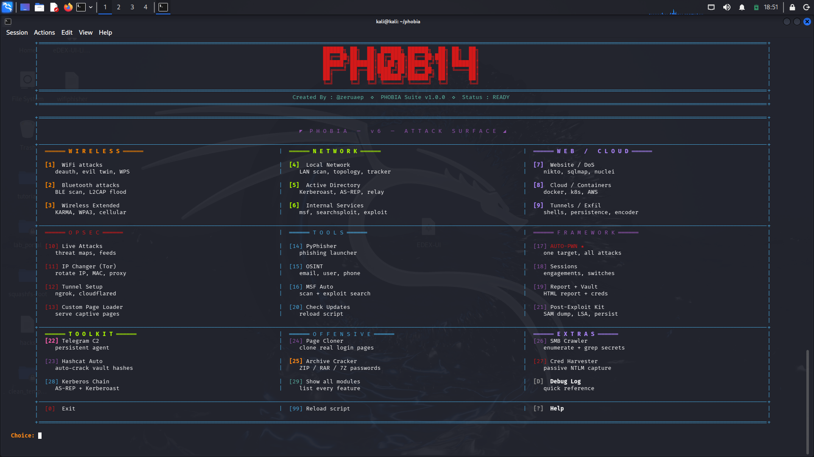
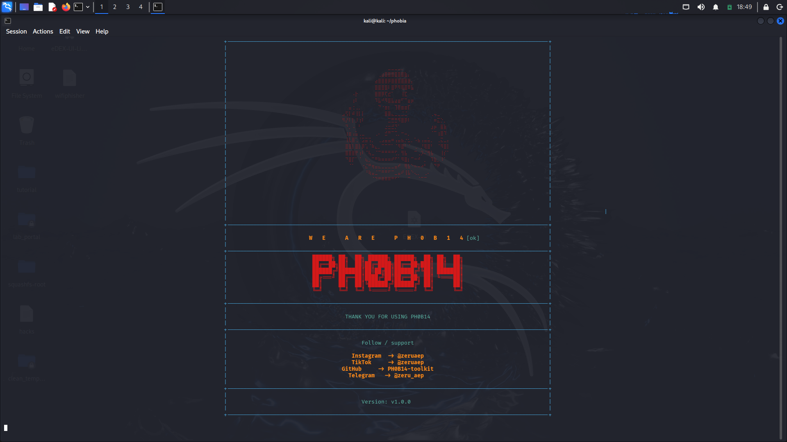
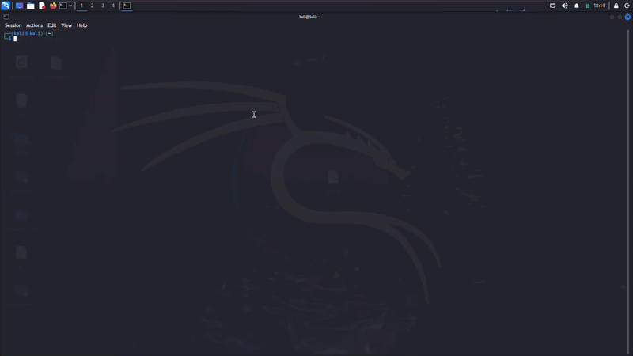
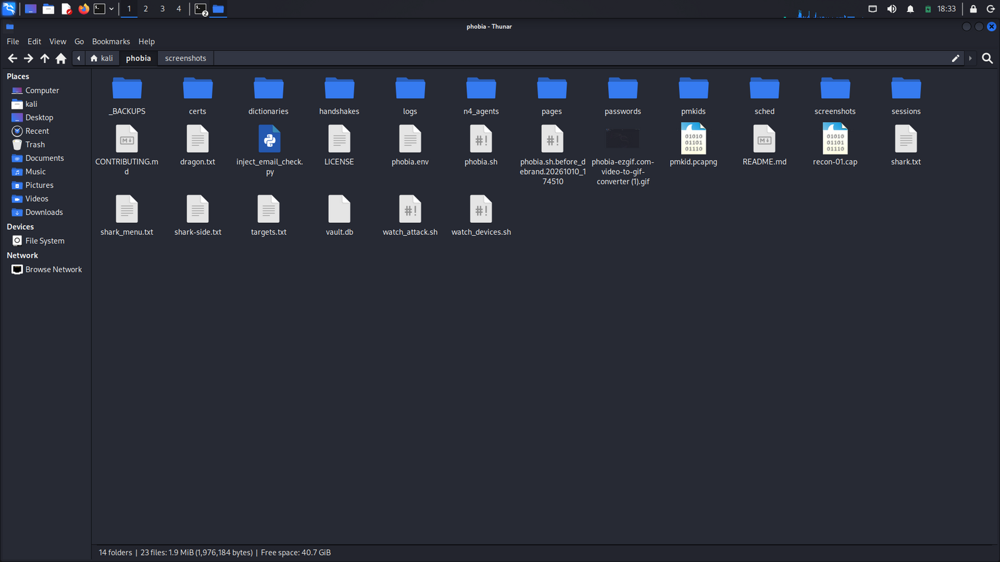
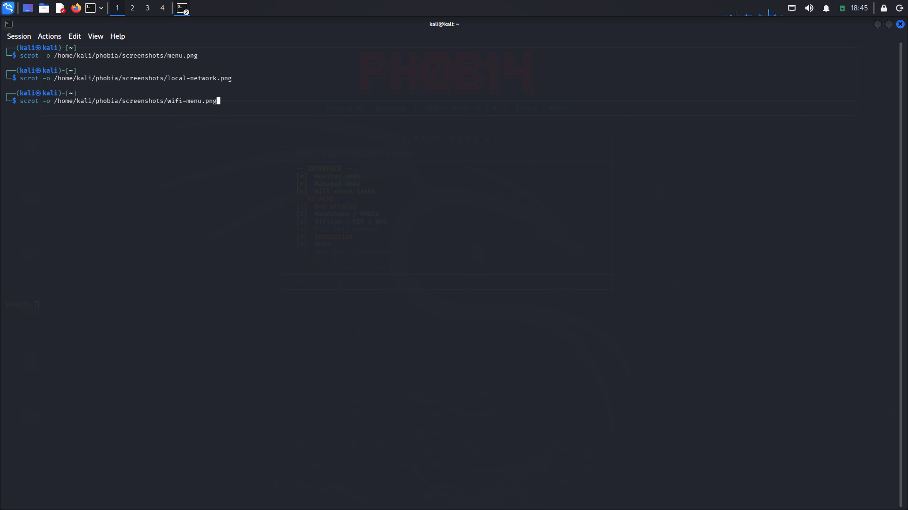

# PHOBIA v1.0.4

  

  <b>One script. 31 modules. Recon → exploit → own.</b>

  
  
  
  
  
  
  

  <i>First all-in-one bash pentesting framework from Ethiopia 🇪🇹</i> 
  Created by <a href="https://tiktok.com/@zeruaep"><b>@zeruaep</b></a>

---

## Table of Contents

- [The intro](#the-intro)
- [Watch it work](#watch-it-work)
- [The 3 that matter](#the-3-that-matter)
- [Status: v1.0.4](#status-v104--early-release)
- [Install](#install)
- [Requirements](#requirements)
- [Modules (full list)](#modules)
- [Configuration](#config-phobiaenv)
- [Known Issues](#known-issues)
- [Contributing](#contributing)
- [License](#license)
- [Credits](#credits)

---

## The intro

  

<i>skull flash → "WE ARE PH0B14" typing animation</i>

---

## Watch it work

  

<i>opening the tool → navigating menus → running a network scan → returning to menu</i>

---

## The 3 that matter

<table>
<tr>
<td width="33%">

### 🎯 [17] AUTO-PWN
Point at a target. Full attack chain runs.

</td>
<td width="33%">

### 📡 [22] Telegram C2
Persistent agents. Control from your phone.

</td>
<td width="33%">

### 🔓 [30] Kerberos Chain
AS-REP + Kerberoast + auto-crack.

</td>
</tr>
</table>

---

## Status: v1.0.4 — early release

Honest split of what's tested vs. what isn't.

### ✅ Stable — tested, working

- WiFi scanning + handshake capture
- Local Network scan + topology
- MSF auto-scan (nmap → msfdb → module match)
- Page Cloner (phishing template downloader)
- Archive Cracker (ZIP / RAR / 7Z)
- Hashcat Auto (hash type detection + crack)
- SMB Enumeration
- OSINT suite
- Session management + credential vault + HTML reports
- Tunnel Setup (ngrok / cloudflared)

### ⚠️ Experimental — works, rougher edges

- Evil Twin captive portal (iOS + Android ≤ 12 only — see Known Issues)
- Kerberos Chain (needs valid DC on network)
- Post-Exploit Kit (needs admin creds on target)
- Cred Harvester (needs victim auth traffic on LAN)
- SMB Crawler (depends on share permissions)
- Telegram C2 (requires your own bot + token)

### 🚧 In Progress — partial

- Android 12+ captive portal support
- Bluetooth classic scan (adapter-dependent)
- Wireless Extended (KARMA, WPA3 — specific hardware required)

**Full list:** [Known Issues](#known-issues)

---

## The interface

<table>
<tr>
<td width="50%">

<i>Local Network submenu</i>

</td>
<td width="50%">

<i>WiFi attack menu</i>

</td>
</tr>
</table>

## What it does

PHOBIA is a menu-driven pentesting framework for Kali Linux. It wraps common tools
(nmap, msf, responder, hashcat, aircrack-ng, impacket, and 20+ more) into a single
unified TUI with session management, credential vault, and automated attack chains.

**Use only on systems you own or have explicit written permission to test.**

---

## Watch it in action

- **Main account (editing)**: [tiktok.com/@zeruaep](https://tiktok.com/@zeruaep)
- **PHOBIA demos**: [tiktok.com/@phobia_toolkit](https://tiktok.com/@phobia_toolkit)
- **Instagram**: [instagram.com/zeruaep](https://instagram.com/zeruaep)

---

## Status

**v1.0.0 — first public release.**

This is an early release. Most modules are functional but some have known quirks.
See [Known Issues](#known-issues) below.

---

## Modules

### Wireless
- WiFi attacks (deauth, evil twin, WPS, handshake capture)
- Bluetooth (BLE scan, SDP, L2CAP flood, AppleBLE, BlueDucky)
- Wireless Extended (KARMA, WPA3 flood, SDR, physical)

### Network
- Local Network (scan, topology, tracker, MITM, rogue DHCP)
- Active Directory (kerberoast, AS-REP, relay, BloodHound, spray)
- Internal Services (nmap full, MSF auto-import, DB connect)

### Web / Cloud
- Website / DoS (nikto, sqlmap, xss, nuclei, floods)
- Cloud / Containers (docker API, k8s, AWS keys, escape)
- Tunnels / Exfil (reverse shells, chisel, ligolo, iodine)

### Ops
- Live Attacks (threat maps, feeds)
- IP Changer (Tor rotation, MAC, proxychains)
- Tunnel Setup (ngrok, cloudflared, local HTTP)
- Custom Page Loader (captive portal pages)
- PyPhisher (external phishing launcher)
- OSINT (email, username, phone, domain)

### Framework
- **AUTO-PWN** — full chain on one target
- Sessions, Report + Vault
- Post-Exploit Kit (SAM, LSA, persistence)
- Telegram C2 (persistent agent)
- Hashcat Auto, Archive Cracker
- Page Cloner, SMB Crawler, Cred Harvester, Kerberos Chain

---

## Install

    git clone https://github.com/PH0B14-toolkit/phobia.git
    cd phobia
    chmod +x phobia.sh
    cp .env.example phobia.env
    sudo bash phobia.sh

Edit `phobia.env` with your own values (wordlists path, telegram bot, etc.)

---

## Requirements

- Kali Linux or any Debian-based distro
- Root (`sudo`) — needs raw sockets, monitor mode, iptables
- Tools: aircrack-ng, hostapd, dnsmasq, xterm, msf, impacket, responder,
  hashcat, john, nmap, smbclient

Install all at once:

    sudo apt install aircrack-ng hostapd dnsmasq xterm nmap smbclient \
        hashcat john responder impacket-scripts sqlmap nikto hydra ffuf nuclei

---

## Wordlists

Not shipped (too big). Get them:

    sudo apt install wordlists
    gunzip /usr/share/wordlists/rockyou.txt.gz

Or drop them in `dictionaries/` or set `PHOBIA_WORDLIST_DIR` in `phobia.env`.

---

## Telegram C2 (optional)

Create a bot via [@BotFather](https://t.me/BotFather), get the token + your chat id,
put them in `phobia.env`. Module `[22] Telegram C2` builds and serves agents.

---

## Usage

    sudo bash phobia.sh

Navigate the wide TUI with number keys. Every action ends with output + returns
to menu. All loot goes to `sessions/<engagement>/` — creds go to `vault.db`.

**Keybindings:**
- `Ctrl+C` once → return to main menu
- `Ctrl+C` twice (within 3s) → quit + cleanup

---

## Config (`phobia.env`)

Never committed. Copy from `.env.example`:

    PHOBIA_BOT_TOKEN="1234567890:ABC..."
    PHOBIA_CHAT_ID="123456789"
    PHOBIA_BOT_NAME="@your_bot"
    PHOBIA_WORDLIST_DIR="/usr/share/wordlists"

---

## Known Issues (v1.0.0)

Being honest — this is a fresh release with a few rough edges:

- **`[0] Exit` sometimes doesn't quit cleanly** from certain submenus. Workaround:
  use `Ctrl+C` twice (within 3 seconds) to force quit with cleanup. This is the
  recommended exit path in v1.0.0.
- **`[D] Debug Log` inside the main menu** — the return path from the log view
  may land on the Help page instead of the main menu. `Ctrl+C` once fixes it.
- **DNS spoof mode picker** and a few other submenus still print outside the wide
  box — cosmetic only. Menus still work.
- **Terminal size:** tested at 120x30 and above. Below that, the wide layout may
  wrap or scroll.
- **Bluetooth scans:** some adapters (Realtek RTL8761) will not see classic devices
  in monitor mode. Use BLE scan for those.
- **Evil Twin captive portal** works reliably on iOS and Android ≤ 12. On Android 12+
  the captive-portal prompt behaviour changed and detection is less reliable —
  support for 12+ is in progress for v1.0.1.
- **Tested on Kali Linux only.** Debian should work but is not tested.

These will be fixed in v1.0.1. Issues + PRs welcome.

---

## Legal

**FOR AUTHORIZED SECURITY TESTING ONLY.**

Every module in this framework — wifi deauth, SMB relay, phishing, C2, credential
harvesting — is illegal to use against systems you don't own or have written
permission to test. In most jurisdictions this includes unauthorized access,
interception of communications, credential theft, and denial of service.

**You alone are responsible for how you use this tool.** The author is not liable
for misuse, damages, or legal consequences. If you're unsure whether your use
case is legal — it isn't. Don't use it.

---

## Contributing

See [CONTRIBUTING.md](CONTRIBUTING.md). PRs welcome for:
- bug fixes (see Known Issues)
- new modules
- portability improvements
- documentation

---

## License

MIT — see [LICENSE](LICENSE).

---

## Credits

Built by **@zeruaep** — Ethiopia, 2026.

Follow for updates:
- TikTok: [@zeruaep](https://tiktok.com/@zeruaep) · [@phobia_toolkit](https://tiktok.com/@phobia_toolkit)
- Instagram: [@zeruaep](https://instagram.com/zeruaep)
- GitHub: [PH0B14-toolkit](https://github.com/PH0B14-toolkit)

**v1.0.0** — first public release. More coming.
